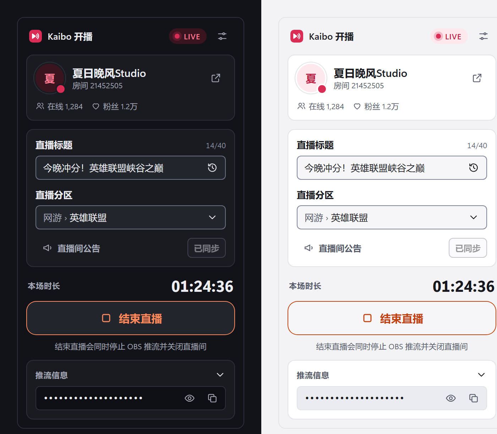

  
  
  
  
  
  

<b>Go live on Bilibili from OBS in one click.</b> QR sign-in · title and area · automatic stream settings · dropped-stream alerts · 简体 / 繁體 / English

<a href="https://github.com/PZW152/obs-kaibo/releases/latest">Download</a> · <a href="README.md">简体中文</a> · <a href="README.zh-TW.md">繁體中文</a>

## What it does

Kaibo is an OBS Studio dock. After signing in once, going live is one button: it syncs any edited title, area and room announcement to Bilibili, opens your live room, writes the RTMP server and key into OBS and (by default) starts streaming. Ending is one button too: it stops OBS streaming, closes the room and tells you how long you were live.

Also: in-dock QR sign-in with scanned/expired states, area search with recents, title history, a clear status for every combination of room and OBS state (with the one action that fixes it), one-click restream after a drop, closing the room when OBS exits, restoring your previous stream settings after ending (for multi-platform streamers), the face-verification QR when Bilibili asks for it, hotkeys, dark/light themes that follow OBS, and Simplified Chinese / Traditional Chinese / English. On Windows the sign-in is encrypted with DPAPI.

## Install

Requires **OBS Studio 30 or newer**.

- **Windows**: download `obs-kaibo-<version>-windows-x64-installer.exe` from [Releases](https://github.com/PZW152/obs-kaibo/releases/latest), close OBS and run it. It installs to `C:\ProgramData\obs-studio\plugins\obs-kaibo` (works for the Steam build of OBS too). Running a newer installer upgrades in place and keeps your settings.
- **macOS**: install `obs-kaibo-<version>-macos-universal.pkg`.
- **Linux**: `.deb` for Ubuntu/Debian; `.flatpak` for the Flatpak build of OBS.

Open the dock from **Docks → Kaibo** or **Tools → Kaibo**.

## Uninstall and data

Uninstall "Kaibo for OBS Studio" from Windows Settings → Apps. Your settings and sign-in are **kept by default**; the uninstaller asks whether to delete them. You can also use **Settings → Delete all Kaibo data** in the dock. Every file Kaibo writes is listed in [docs/privacy.md](docs/privacy.md).

## Credits and license

Kaibo is a rewrite of [Zarosmm/obs-bilibili-stream](https://github.com/Zarosmm/obs-bilibili-stream); thanks to Zaros and all contributors. Licensed under [GPL-2.0](LICENSE). Kaibo is an independent open-source tool, not affiliated with or endorsed by Bilibili.
